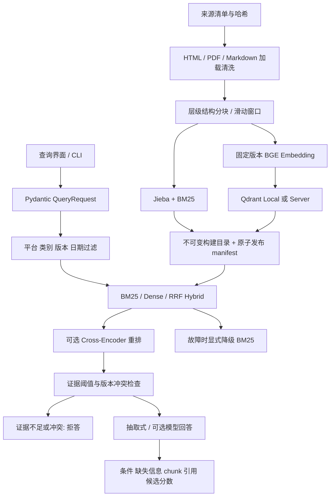

# 架构与完整请求流程

## 一次请求

1. `api.py` 校验问题、模式、Top-K 和上下文。问题限长并拒绝全空白；不接受任意下载 URL 或文件上传。
2. `service.py` 合并显式 filter 与 context，问题补充型号和诉求用于召回。购买/签收和使用状态进入回答上下文，但默认抽取器不自动裁定资格，也不计算法律期限。
3. `RetrievalService` 加载固定 manifest，校验源文档/清单 hash、分块参数、模型 revision、后端和索引文件 hash。源内容变化要求重建。评测另存 Python 源码 hash。
4. BM25 在符合元数据条件的 chunk 集合中计算 IDF；Dense 使用相同条件的 Qdrant payload 过滤。日期是闭区间；未知生效日期在指定日期查询时排除。没有指定星云平台时剔除合成材料。
5. BM25 保留正得分命中，Dense 使用余弦；Hybrid 对每路排名累加 `1/(60+rank)`。最多保留 candidate_k 个候选供 CrossEncoder。
6. `hybrid_rerank` 对 query-document 对推理后按得分重排，保留原始 BM25/Dense/RRF、重排分和前后名次。CrossEncoder 不能挽救根本没召回的证据。
7. 不把 RRF 当正确概率；各模式分别使用预先固定的工程阈值。同系列多个证据版本冲突时要求用户补充版本/适用期。只把达阈值片段交给生成器。
8. 默认 `extractive-v1` 返回证据文本、条件片段、缺失信息与真实 chunk ID。可选模型通过兼容接口生成结构化 JSON，并验证引用 ID 范围及正文标记。ID 合法不等于事实被证据蕴含。
9. 输出包含实际模式、降级原因、索引版本、检索/生成耗时、候选轨迹和引用来源。服务日志不写 Key、原问题或完整答案。

## 故障与并发

Embedding 或 Qdrant 查询失败降级到 BM25；CrossEncoder 失败降级到 Hybrid；提供商失败降级抽取式。所有响应标记实际模式和原因，评测不把降级当完整模型实验。局部库错误被转换为不暴露 URL 凭证的异常类别。

FastAPI 将同步推理移到线程，整个请求有上限；单个模型服务锁避免 CPU 队列无限增长，忙碌返回 429，超时返回 504。Python 线程无法强制取消 PyTorch 内核，超时后锁保持到推理实际退出；生产级强隔离应使用独立推理进程。网络下载和生成请求均有超时及最多 3 次传输失败重试，不无限重试业务错误。

Qdrant Local 单进程独占数据目录，因此本地 CLI 评测与服务不可同时打开同一索引。Compose 使用 Qdrant Server 和独立卷。构建失败不覆盖原 manifest；旧版本保留以便审计，未实现自动清理。`/health` 是索引和配置概览，`/ready` 查询向量 collection 存在性，不保证模型已预热。

## 检索与生成评测

固定 qrels 为文档级，指标先对返回的最多 5 个 chunk 去重得到文档排序。Recall@K、MRR@5、nDCG@5 不包含无答案样例。该口径宽松，相关文档中的错误段落仍可能算命中；原始 chunk 列表用于失败检查。引用 Precision/Recall 也只是相关文档 ID 的匹配，不是逐句事实判断。

生成报告独立保存所有答案、拒答、引用、接受率、引用覆盖率和耗时。不能只说无答案拒答 100% 而隐瞒可回答问题被拒绝的比例。默认无 LLM-as-Judge，不使用生成规则自身评分来宣称泛化。
